# Vitre

A glass desktop for GNOME. Free and open source.

**Website:** [chrismteryli.github.io/vitre](https://chrismteryli.github.io/vitre/)

Vitre is a set of GNOME Shell extensions, a theme, icons, a cursor and wallpapers that work together. Most of the work went
into how things move: menus, windows, swipes and dialogs.

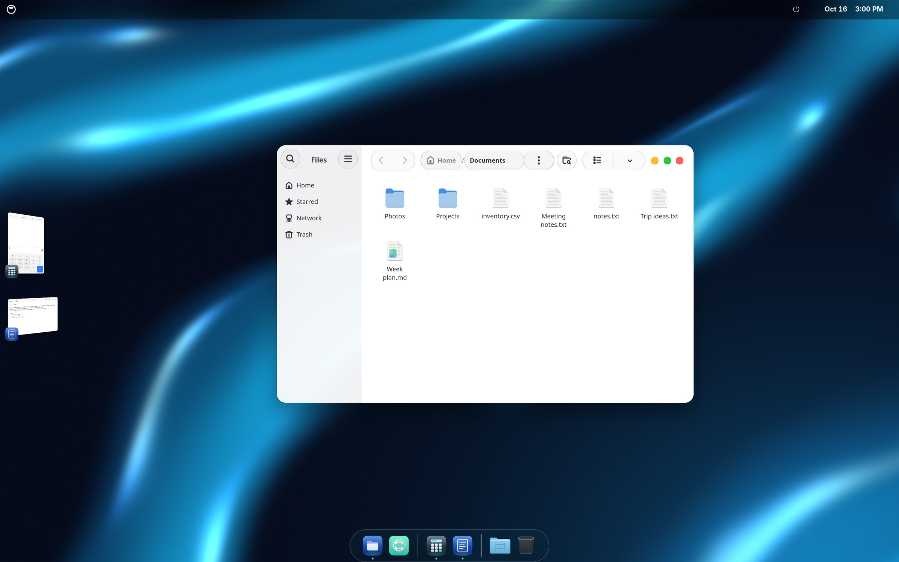

## See it move

[Watch the 27 second demo](docs/media/vitre-demo.mp4) (open the file on GitHub to play it).

The glass stretches out of whatever you click and stays attached until it lands. These were recorded frame by frame in GNOME Shell and are played back at true speed.

| Menus | Control Center | Notification Center |
|---|---|---|
| 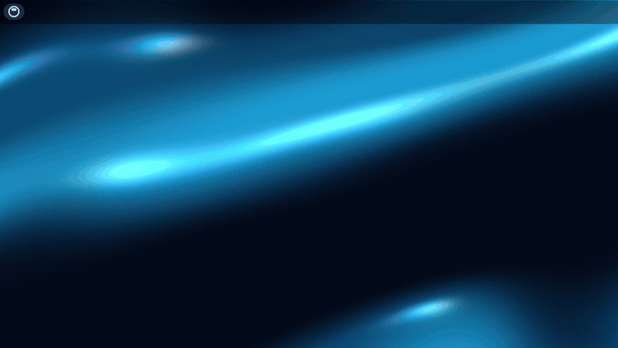 | 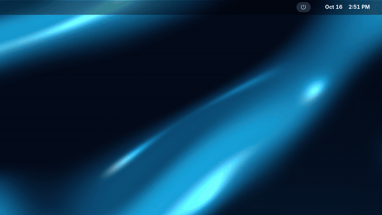 | 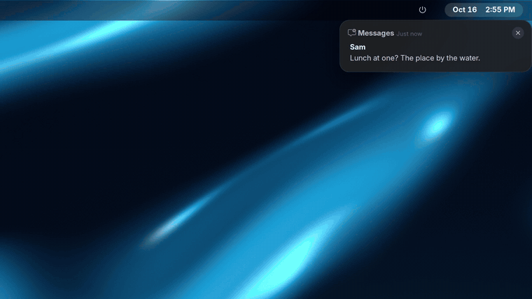 |

## Screenshots

| | |
|---|---|
| 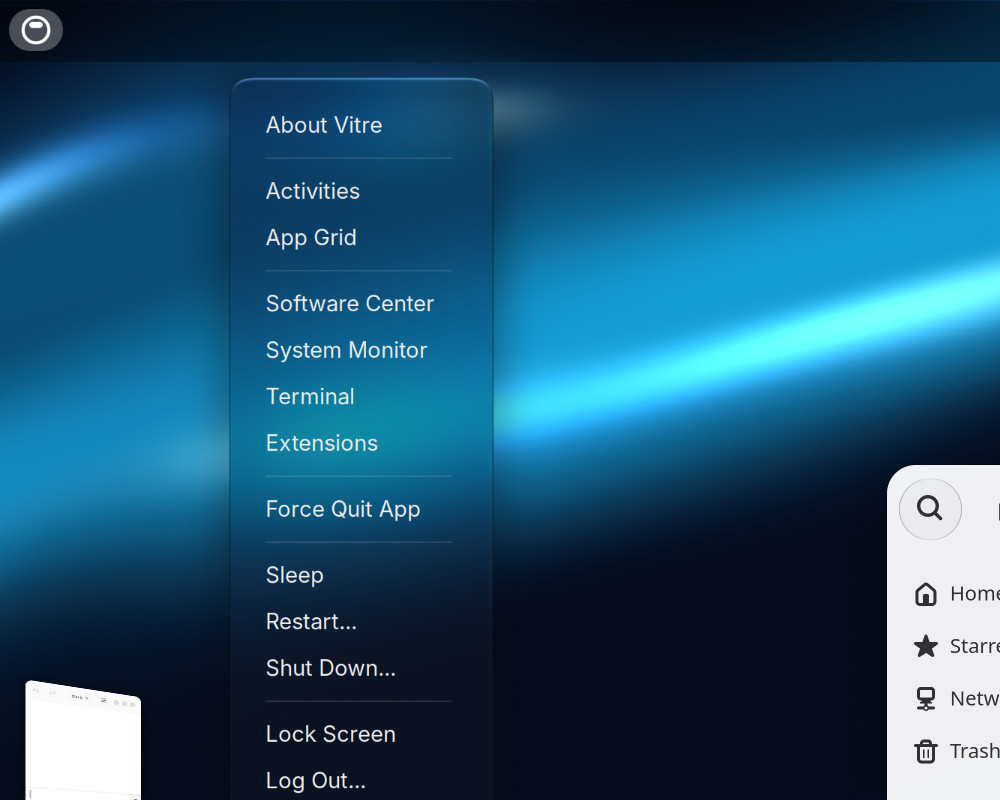<br>**The logo menu** | 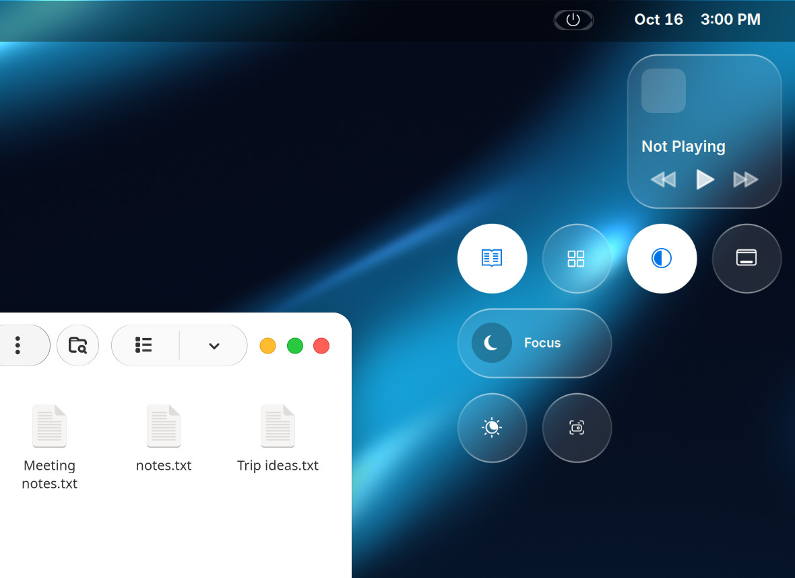<br>**Control Center** |
| 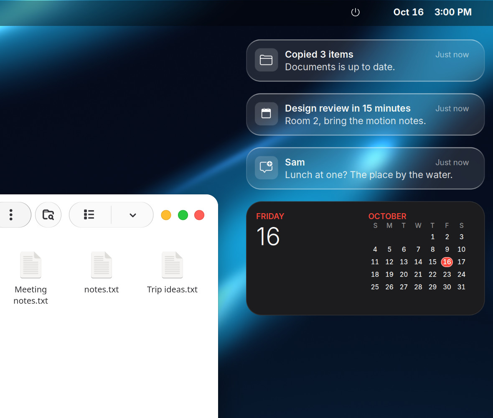<br>**Notification Center** | 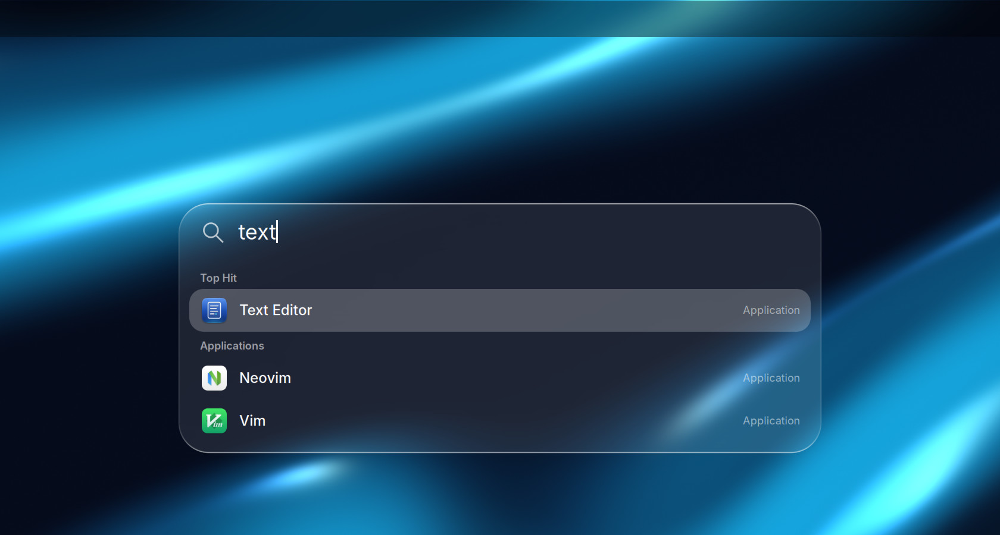<br>**Search** (Super+Space) |
| 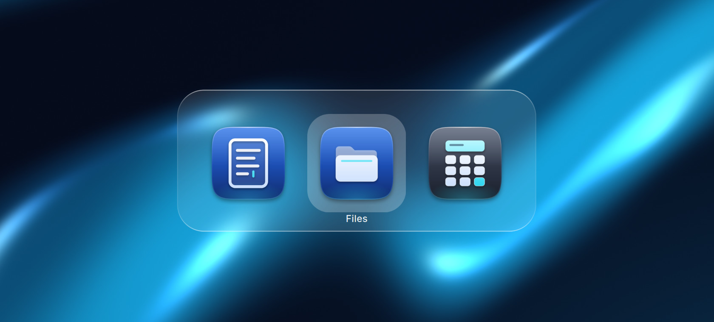<br>**The switcher** (Super+Tab) | 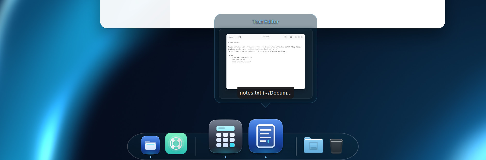<br>**Dock window previews** |

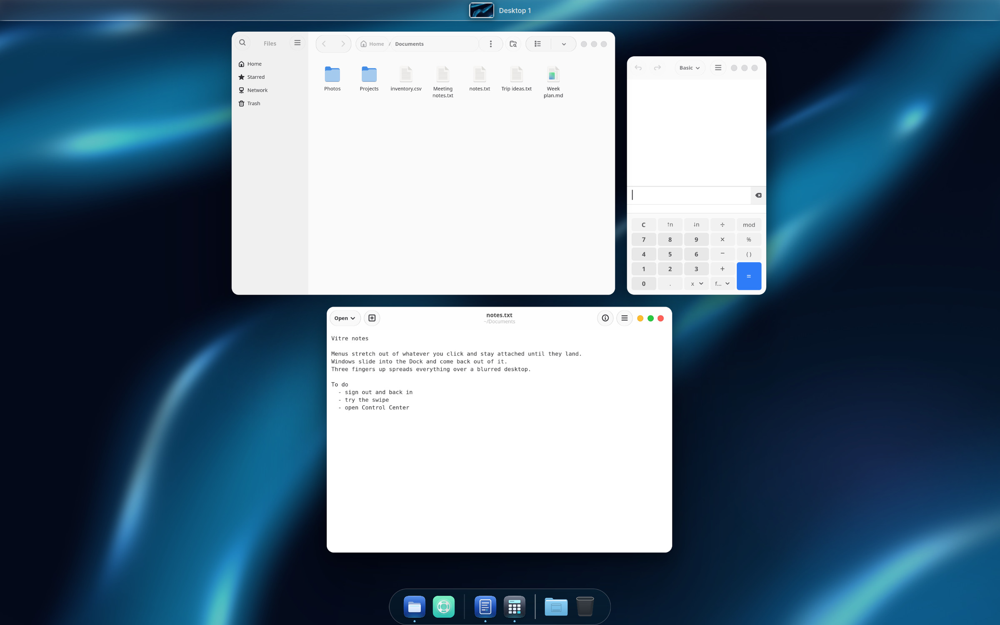

Three fingers up spreads your windows over the blurred desktop.

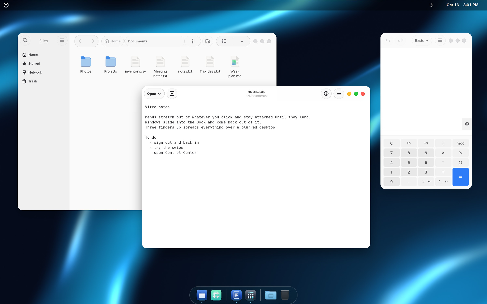

## What you get

- **Glass that stretches.** Top bar menus, Control Center, Notification Center, the volume and brightness bar, app menus,
  Dock menus, system dialogs and the lock screen all open the same way. The glass stretches out of whatever you clicked
  and stays attached to it until it lands, then hands over to the real menu. Closing plays it back.
- **Windows that fly.** A window you minimize slides into its Dock icon. Restoring flies it back out. New windows grow in,
  closing windows shrink away, and the Dock icon hops while an app starts.
- **Stage.** Your other apps wait in a strip on the left. Click one and it slides out of its thumbnail into place, and
  the window you were using flies back into the strip.
- **Swipe up.** Three fingers up spreads your windows out over a dimmed, blurred desktop, with your workspaces in a glass
  bar at the top. Drag a window onto the strip to park it, or drag a pile out of the strip onto the windows.
- **Workspaces.** Switching workspaces steps the old one back and brings the next one forward on the same spring, and a
  swipe follows your fingers.
- **Fullscreen.** A video or window grows into fullscreen in one motion and lands back where it was. In fullscreen, push the
  pointer into the top-right corner for the time, the battery and the Control Center.
- **Search.** Super+Space opens a search bar for apps, files and settings, with an Apps view.
- **Switcher.** Super+Tab and Alt+Tab show a glass app and window switcher.
- **Dock.** A magnifying Dock with window previews. Vitre Dock is a fork of Dhruva with Vitre's changes. It has its own name, so GNOME's
  automatic extension updates leave it alone.
- **Look.** The Vitre-Glass theme for apps and the shell, Vitre icons, an original glass-drop cursor set with a busy spinner, and the
  Vitre Drift wallpapers.

Everything respects GNOME's animation setting. With animations off or reduced motion on, GNOME's own behaviour runs.

## Requirements

- GNOME Shell 51 on Wayland. Built and tested on Ubuntu 26.10 (arm64). x86_64 runs the same JavaScript and CSS but has not
  been tested yet.
- The Inter and JetBrains Mono fonts (the installer prints the package names if they are missing).
- An internet connection during install. The base icon theme (MacTahoe's glyphs and folders, without its app icons) is fetched from
  its own project at a fixed version. To install offline, point `VITRE_ICONS_SRC` at a checkout of MacTahoe-icon-theme.

## Install

```bash
git clone https://github.com/chrismteryli/vitre.git
cd vitre
./install.sh
```

Then sign out and back in. The installer puts everything in your home folder and needs no root.

`./install.sh --check` only checks your system and changes nothing. If something goes wrong, `./vitre-info.sh` prints what
a bug report needs (GNOME version, distro, CPU and the last Vitre log lines) and also changes nothing.

The installer also turns off the Ubuntu Dock (and Dash to Dock, Dash to Panel, Dhruva and the Compiz magic lamp effect if you have
them), because Vitre brings its own Dock. If you use Dhruva, its settings are copied to Vitre Dock first. It moves GNOME's input-source switch from Super+Space to the keyboard key, so
Super+Space can open Search. If you switch keyboard layouts with Super+Space, change that in Settings after installing.

## Install as its own session (apt, optional)

Vitre also comes as Debian packages that add a **Vitre** session to the login screen. Ubuntu stays in the list as the way back.
This one needs sudo:

```bash
curl -fsSLO https://chrismteryli.github.io/vitre/apt/install-native.sh
sh install-native.sh
```

It prints what it will do (add the signing key, add the apt source, install `vitre-desktop`) and waits for you to type `yes`. Then
sign out, click the gear on the login screen and pick Vitre. The steps by hand are in
[the apt instructions](https://chrismteryli.github.io/vitre/apt/INSTALL.md).

## Uninstall

```bash
./uninstall.sh
```

The installer backs up your settings and any files it replaces (in `~/.local/share/vitre-backup`). The uninstaller puts
them back. Each uninstall undoes the most recent install, so if you installed twice, run it twice to get back to where you
started. Sign out and back in afterwards.

## Login screen and boot splash (optional)

The Vitre login screen and boot splash need root, so `install.sh` leaves them out. They have their own installer in
`system/`. Run `./system/install-system.sh --check` first. It only looks at your system and changes nothing.
[system/README.txt](system/README.txt) has the rest, including how to put Ubuntu's login screen and splash back.

## Known limits

- This is an early release, tested on one machine. Expect rough edges and please report them.
- Apps that draw their own window buttons (Claude, ChatGPT and other Electron apps) keep them. Vitre cannot restyle those.
- Brave: set Settings, Appearance, Theme to GTK to get Vitre's window buttons.
- GNOME Shell pauses for 20 to 40 ms about every ten seconds while it cleans up memory. It is GNOME's own and shows up as
  a skipped frame now and then.
- The first time you open each top bar panel after login can hitch once. Vitre draws them once in the background after
  login to avoid it.
- The login screen and boot splash installer in `system/` is new. So far it has only been run with `--check`.

## Credits and licence

Vitre is GPL-3.0. It builds on Dhruva (Vitre Dock is a fork of it), Blur my Shell, Just Perfection, Liquid Glass, Logo Menu, Rounded Window Corners
Reborn, and the MacTahoe and WhiteSur themes by Vince Liuice. See [CREDITS.md](CREDITS.md) for the full list and their
licences.

## Who made this

Built by Christopher Molina, founder of [Teryli](https://teryli.com).
