# Vitre

A glass desktop for GNOME. Free and open source.

[](https://github.com/chrismteryli/vitre/actions/workflows/ci.yml)

**Website:** [chrismteryli.github.io/vitre](https://chrismteryli.github.io/vitre/)

Vitre is a set of GNOME Shell extensions, a theme, icons, a cursor and wallpapers that work together. Most of the work went
into how things move: menus, windows, swipes and dialogs.

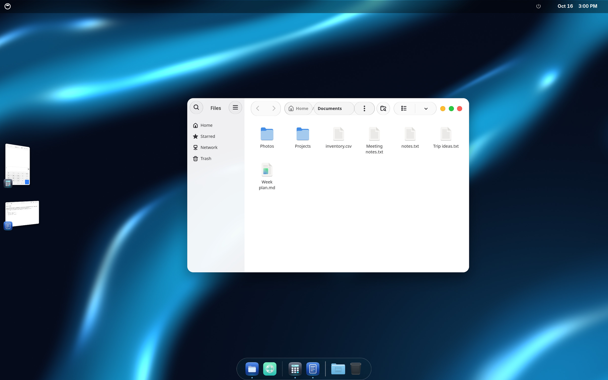

The screenshots and clips below are from 0.2.0. Since then the Stage strip has moved to a band at the bottom beside the Dock.

## See it move

[Watch the 27 second demo](docs/media/vitre-demo.mp4) (open the file on GitHub to play it).

The glass stretches out of whatever you click and stays attached until it lands. These were recorded frame by frame in GNOME Shell and are played back at true speed.

| Menus | Control Center | Notification Center |
|---|---|---|
| 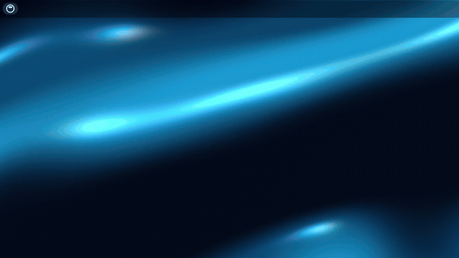 | 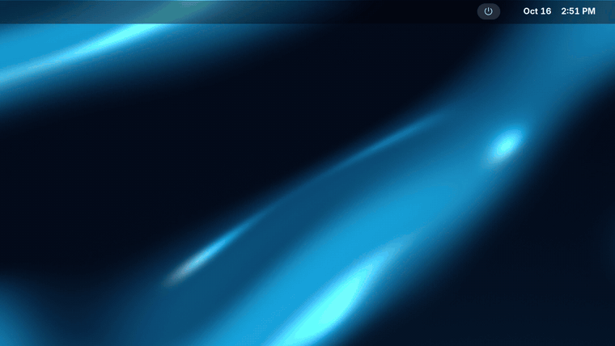 | 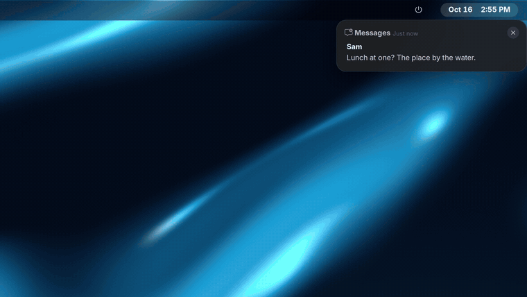 |

## Screenshots

| | |
|---|---|
| 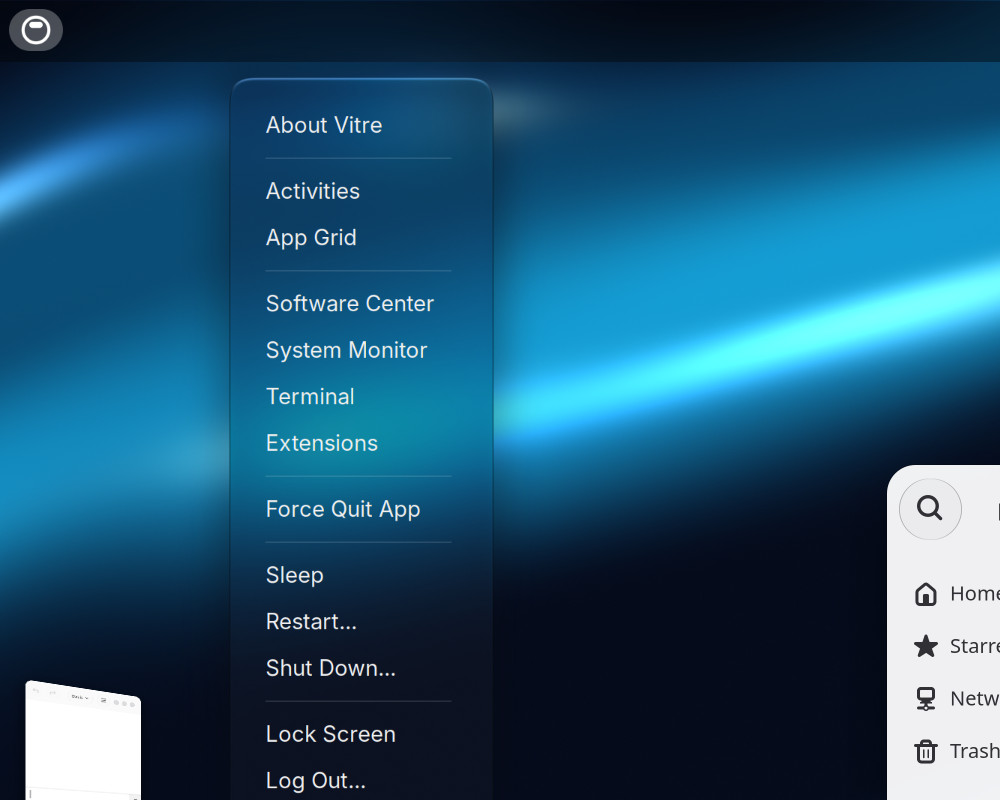<br>**The logo menu** | 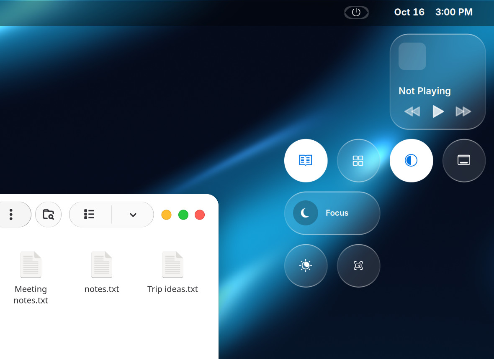<br>**Control Center** |
| 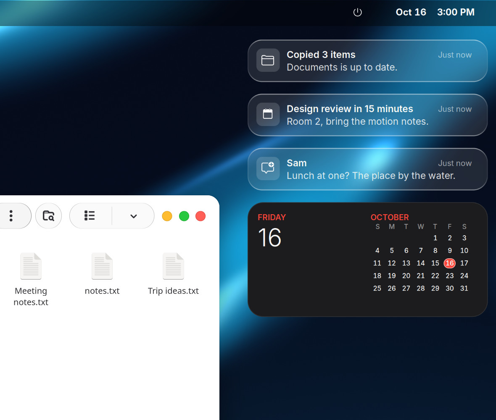<br>**Notification Center** | 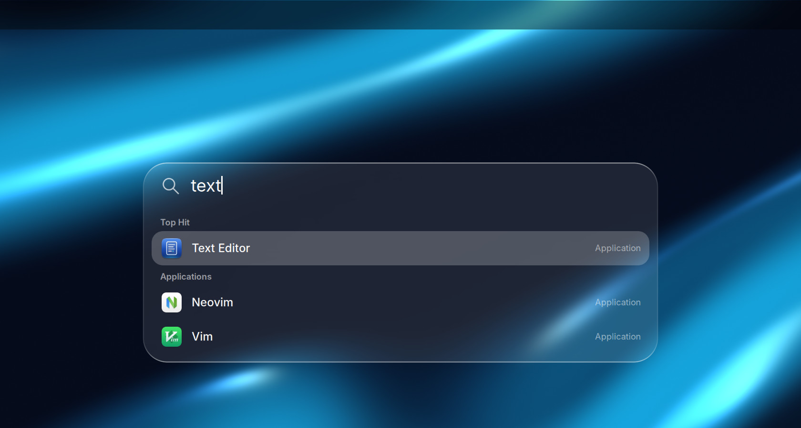<br>**Search** (Super+Space) |
| 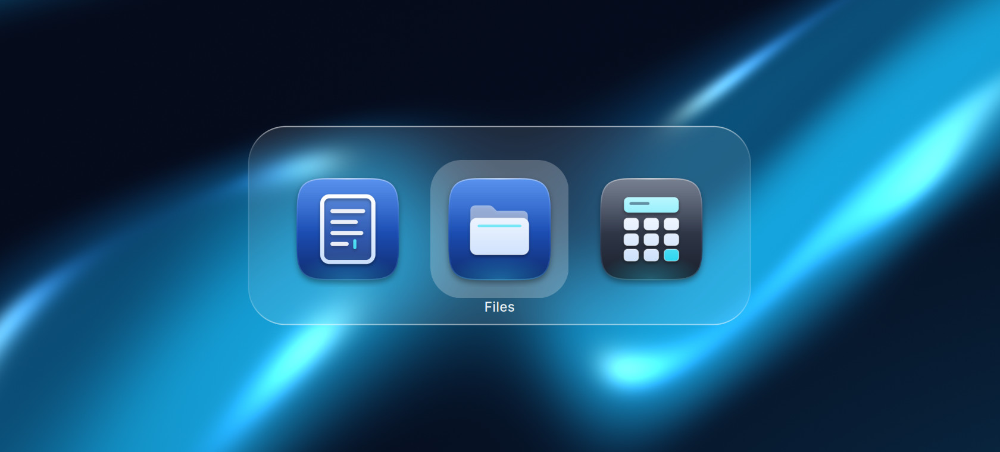<br>**The switcher** (Super+Tab) | 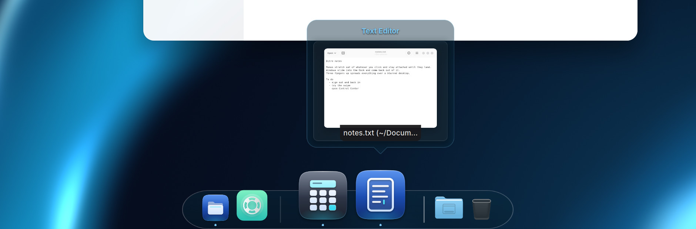<br>**Dock window previews** |

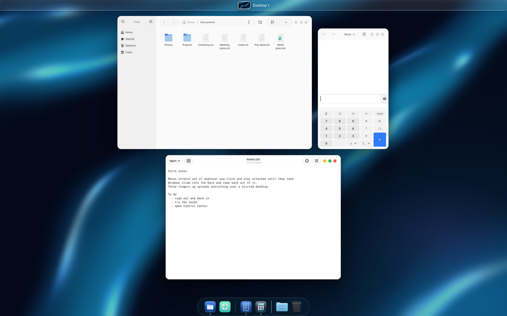

Three fingers up spreads your windows over the blurred desktop.

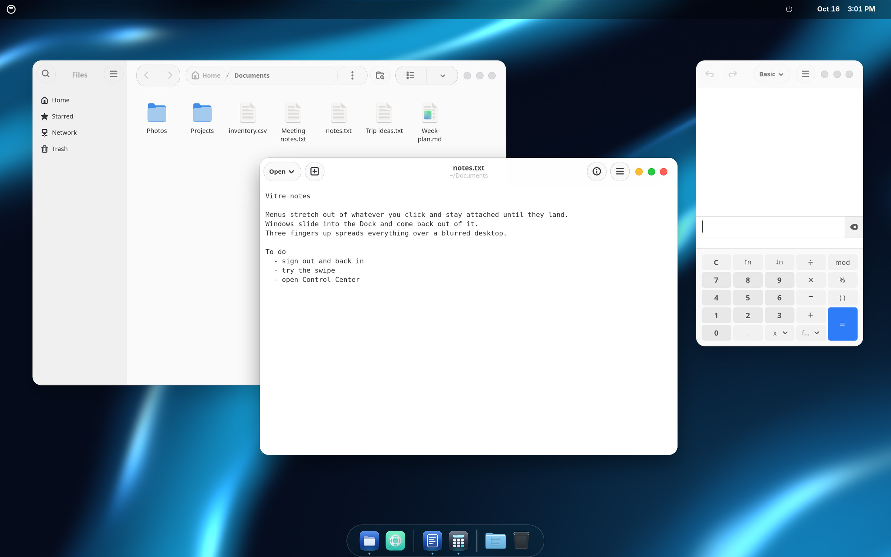

## What you get

- **Glass that stretches.** Top bar menus, Control Center, Notification Center, the volume and brightness bar, app menus,
  Dock menus, system dialogs and the lock screen all open the same way. The glass stretches out of whatever you clicked
  and stays attached to it until it lands, then hands over to the real menu. Closing plays it back.
- **Windows that fly.** A window you minimize slides into its Dock icon. Restoring flies it back out. New windows grow in,
  closing windows shrink away, and the Dock icon hops while an app starts.
- **Stage.** Your other apps wait in a band at the bottom, left and right of the Dock, with the most recent one nearest the Dock. Click
  one and it slides out of its thumbnail into place, and the window you were using flies back into the band. (A setting brings back the
  old column on the left.)
- **Swipe up.** Three fingers up spreads your windows out over a dimmed, blurred desktop, with your workspaces in a glass
  bar at the top. Drag a window onto the strip to park it, or drag a pile out of the strip onto the windows.
- **Workspaces.** Switching workspaces steps the old one back and brings the next one forward on the same spring, and a
  swipe follows your fingers.
- **Fullscreen.** A video or window grows into fullscreen in one motion and lands back where it was. In fullscreen, push the
  pointer into the top-right corner for the time, the battery and the Control Center.
- **Search.** Super+Space opens a search bar for apps, files and settings, with an Apps view.
- **Switcher.** Super+Tab and Alt+Tab show a glass app and window switcher.
- **Dock.** A magnifying Dock with window previews. Vitre Dock is a fork of Dhruva with Vitre's changes. It has its own name, so GNOME's
  automatic extension updates leave it alone. A Downloads stack sits before the Trash: a pile of your newest files that opens as a fan,
  or as a scrolling grid when there are many. Drag a file out of it onto the Trash or onto an app in the Dock. Drop files on the Trash
  from Files or any app to move them to the trash.
- **Look.** The Vitre-Glass theme for apps and the shell in a dark and a light style, Vitre icons, an original glass-drop cursor set with a
  busy spinner, and the Vitre Drift wallpapers.
- **Accent colours.** Pick one of the nine GNOME accents and the switches, sliders, selections, links and default buttons of your apps
  take it, in GTK 4 and GTK 3, along with the Control Center and Search in the shell.
- **Light and dark on a schedule.** Vitre Appearance can switch the style at sunset and sunrise (from Location Services, else your time
  zone) or at times you pick, and the wallpaper changes with it. It is off until you choose Auto in Vitre Settings.
- **Vitre Settings.** One app for the choices Vitre has: motion, Dock, windows, glass, style, accent and wallpaper. It is in the app grid.
- **One design system.** The shell, the Control Center, the lock screen and the login screen share one set of type sizes, corner radii,
  glass levels and shadows. The window buttons are one capsule as tall as the header buttons, in GTK 4, libadwaita and GTK 3.
- **Tray guard.** A tray item that is gone before its icon loads no longer flashes a loading glyph in the top bar.

Everything respects GNOME's animation setting. With animations off or reduced motion on, GNOME's own behaviour runs.

## Requirements

- GNOME Shell 51 on Wayland. Built and tested on Ubuntu 26.10 (arm64). Installing and starting it on x86_64 is checked on every
  change (see Testing below); the motion itself has only been tried by hand on arm64.
- The Inter and JetBrains Mono fonts (the installer prints the package names if they are missing).
- For Vitre Settings, gjs and libadwaita's typelib (`gjs` and `gir1.2-adw-1` on Ubuntu). A GNOME 51 desktop has both; the installer says
  so if they are missing, and nothing else in Vitre needs them.
- An internet connection during install. The base icon theme (MacTahoe's glyphs and folders, without its app icons) is fetched from
  its own project at a fixed version and checked against a pinned SHA-256 before anything is unpacked or run; the install stops if it
  does not match. To install offline, point `VITRE_ICONS_SRC` at a checkout of MacTahoe-icon-theme.

## Install

```bash
git clone https://github.com/chrismteryli/vitre.git
cd vitre
./install.sh
```

Then sign out and back in. The installer puts everything in your home folder and needs no root.

`./install.sh --check` only checks your system and changes nothing. If something goes wrong, `./vitre-info.sh` prints what
a bug report needs (GNOME version, distro, CPU and the last Vitre log lines) and also changes nothing.

The installer also turns off the Ubuntu Dock (and Dash to Dock, Dash to Panel, Dhruva and the Compiz magic lamp effect if you have
them), because Vitre brings its own Dock. If you use Dhruva, its settings are copied to Vitre Dock first. It moves GNOME's input-source switch from Super+Space to the keyboard key, so
Super+Space can open Search. If you switch keyboard layouts with Super+Space, change that in Settings after installing.

## Install as its own session (apt, optional)

Vitre also comes as Debian packages that add a **Vitre** session to the login screen. Ubuntu stays in the list as the way back.
**The packages are still version 0.2.0**: they do not have Vitre Settings, the accent colour themes, Vitre Appearance, Vitre Tray, the
Downloads stack or the new motion. For those, use `./install.sh` above (it also works on top of the packages). This one needs sudo:

```bash
curl -fsSLO https://chrismteryli.github.io/vitre/apt/install-native.sh
sh install-native.sh
```

It prints what it will do (add the signing key, add the apt source, install `vitre-desktop`) and waits for you to type `yes`. Then
sign out, click the gear on the login screen and pick Vitre. The steps by hand are in
[the apt instructions](https://chrismteryli.github.io/vitre/apt/INSTALL.md).

## Fedora and Arch (recipes, not published yet)

`packaging/` has an RPM spec for COPR and a PKGBUILD for the AUR, in the same ten-package split as the `.deb`s. Nothing is published and
neither has been built on Fedora or Arch yet; they build the v0.2.0 tag, so like the `.deb`s they do not have anything new in 0.3.0. [packaging/README.md](packaging/README.md) says what was checked and
how to run the checks.

## Uninstall

```bash
./uninstall.sh
```

The installer takes a private backup (`~/.local/share/vitre-backup/<date>-<id>`, readable only by you, one folder per install) of
every file it replaces and of the value of every setting it writes. The uninstaller removes what the install created, puts back what it
replaced, and gives a setting its old value only if Vitre's value is still in place. A setting you changed since the install stays as
you set it, and a setting Vitre never touched is never read or written. Each uninstall undoes the most recent install, so if you
installed twice, run it twice to get back to where you started. Sign out and back in afterwards.

- **Upgrade.** Run `./install.sh` from the new version over the old one. Your Vitre settings stay as they are and only settings that are
  new in this version are added. This works over 0.2.0 too, and `./uninstall.sh` can undo a backup made by 0.2.0.
- **Factory reset.** `./uninstall.sh --factory-reset` restores every setting Vitre owns to its value before the install, even one you
  changed later. It still leaves every other setting alone. (0.2.0 reloaded a dump of all of `/org/gnome/`; that is gone.)
- `./uninstall.sh <backup folder>` undoes a specific install.

## Login screen and boot splash (optional)

The Vitre login screen and boot splash need root, so `install.sh` leaves them out. They have their own installer in
`system/`. Run `./system/install-system.sh --check` first. It only looks at your system and changes nothing.
[system/README.txt](system/README.txt) has the rest, including how to put Ubuntu's login screen and splash back.

## Testing

Every push and pull request is checked on GitHub on x86_64 and arm64. The scripts and settings files are validated, a unit test checks
that Vitre Appearance only asks for your location in Auto mode, Vitre is installed, upgraded over 0.2.0, changed, uninstalled and
factory-reset in an Ubuntu 26.10 container (with the icon theme download checked against its pinned SHA-256), and a real GNOME Shell 51
is started with Vitre installed. Every extension
has to load without a JavaScript error, and the run keeps a screenshot of the desktop. It runs without a screen or a GPU, so it
says nothing about how the motion looks, and it does not cover the apt packages or the login screen installer. The Fedora and Arch
recipes in `packaging/` get their own file checks (`python3 packaging/check-distro.py`) in the static job.

## Known limits

- This is an early release, tested on one machine. Expect rough edges and please report them.
- The Downloads stack and the Trash were tested in a headless GNOME Shell and are new to daily use.
- Dock auto-hide, a second monitor with the Stage band, and keyboard focus rings on the window buttons are not covered by the tests;
  expect gaps there. Over very bright wallpapers the clear glass can be low in contrast, and a few fallback paths (the Dock's own
  minimize effects, a workspace swipe when Vitre Workspaces is off) do not yet follow the reduced motion setting.
- The apt packages and the Fedora and Arch recipes are still 0.2.0 (see above).
- Apps that draw their own window buttons (Claude, ChatGPT and other Electron apps) keep them. Vitre cannot restyle those.
- Brave: set Settings, Appearance, Theme to GTK to get Vitre's window buttons.
- GNOME Shell pauses for 20 to 40 ms about every ten seconds while it cleans up memory. It is GNOME's own and shows up as
  a skipped frame now and then.
- The first time you open each top bar panel after login can hitch once. Vitre draws them once in the background after
  login to avoid it.
- The login screen and boot splash installer in `system/` is new. So far it has only been run with `--check`.

## Privacy and network

Vitre runs as your user and opens no network connection of its own, with these exceptions:

- `install.sh` downloads the base icon theme from github.com once (checked against a pinned SHA-256).
- Vitre Appearance uses GNOME's location service (GeoClue) only in Auto mode with Location Services on, and asks it for a city-level
  position to work out sunset. With a manual or custom schedule it never starts it and uses your time zone.
- The Dock's music module is off by default. When you turn it on, the lyrics lookup sends the track title, artist and length to
  lrclib.net.
- GNOME's own extension updater checks extensions.gnome.org for the third-party extensions in your home folder.

## Credits and licence

Vitre is GPL-3.0. It builds on Dhruva (Vitre Dock is a fork of it), Blur my Shell, Just Perfection, Liquid Glass, Logo Menu, Rounded Window Corners
Reborn, and the MacTahoe and WhiteSur themes by Vince Liuice. See [CREDITS.md](CREDITS.md) for the full list and their
licences.

## Who made this

Built by Christopher Molina, founder of [Teryli](https://teryli.com).
